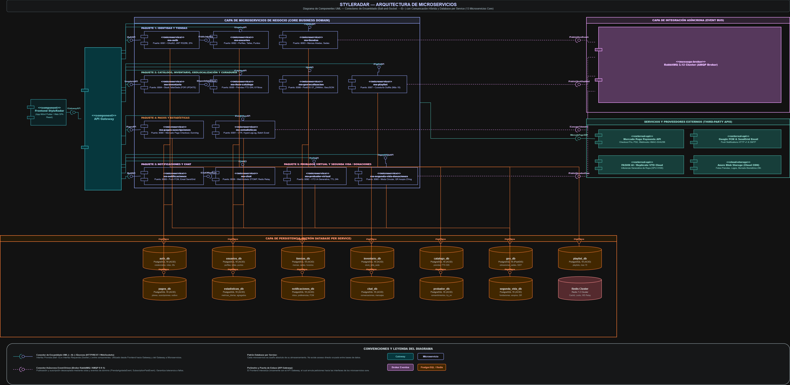
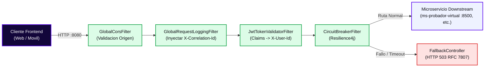
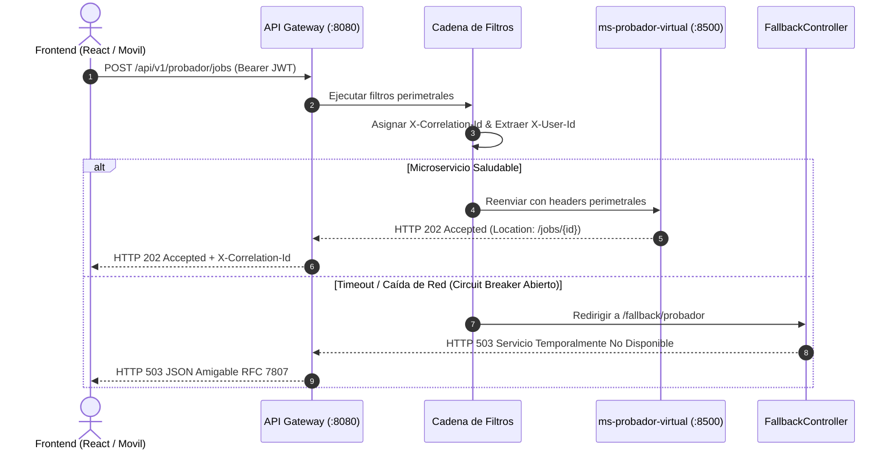
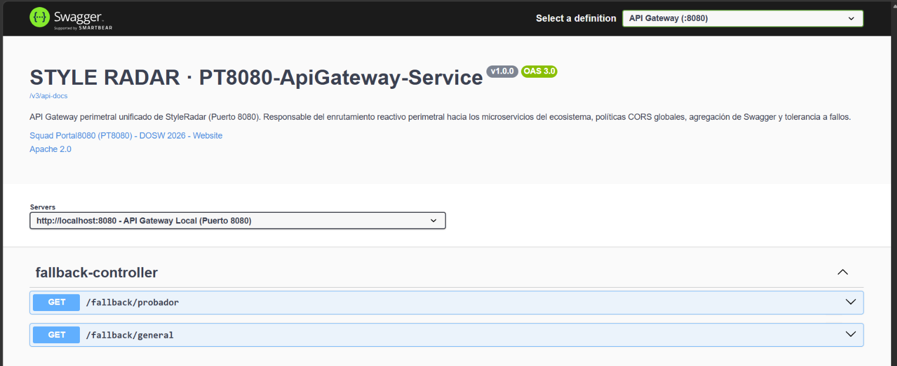
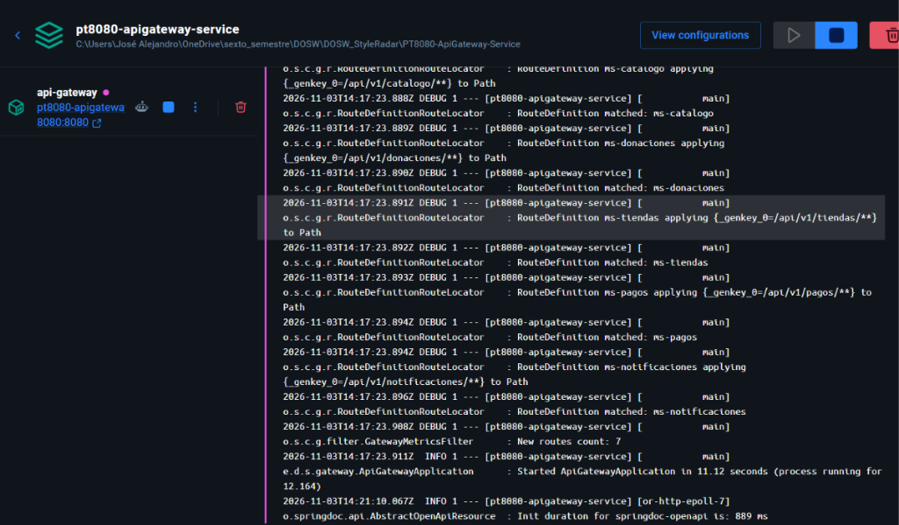
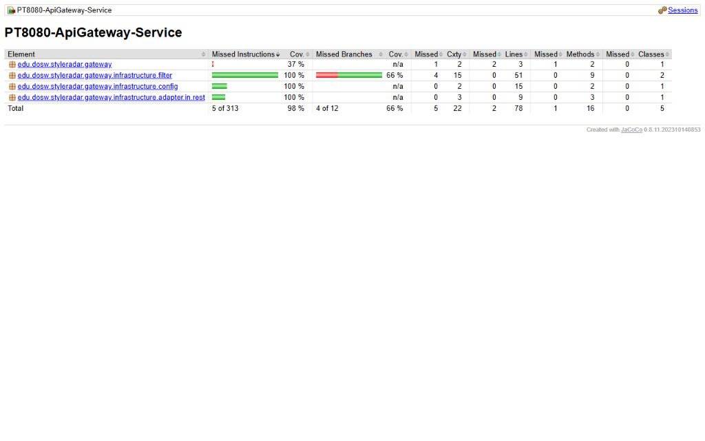
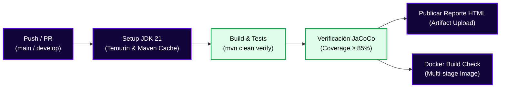
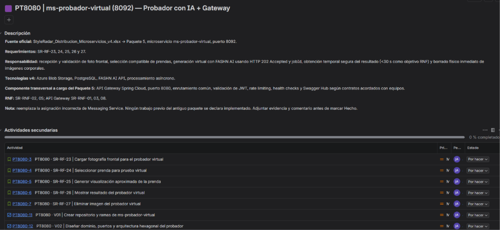

<!-- ==============================================================================
  STYLE RADAR · PLANTILLA MAESTRA DE README PARA MICROSERVICIOS
  Asignatura: DOSW (Diseño y Operación de Soluciones Web) · 2026
  Estándar obligatorio unificado para los componentes del proyecto StyleRadar.
  Componente: PT8080-ApiGateway-Service (API Gateway Perimetral)
  Squad Asignado: Portal8080 (PT8080) · Puerto Oficial: 8080
============================================================================== -->

<div align="center">

  <a href="https://github.com/StyleRadar1">
    
  </a>

  <h1>STYLE<font color="#5600EF">RADAR</font> &nbsp;·&nbsp; <code>api-gateway</code></h1>

  <p align="center">
    
    
    
    
  </p>

  <p align="center">
    <strong><font color="#5600EF">Descubre tu estilo. En tu ciudad.</font></strong><br />
    <em>Puerta de entrada unificada, enrutamiento perimetral reactivo, agregación de Swagger y tolerancia a fallos para StyleRadar Bogotá.</em>
  </p>

  <p align="center">
    <a href="#4-endpoints-y-enlace-a-swagger"></a>
    <a href="#4-endpoints-y-enlace-a-swagger"></a>
    <a href="#4-endpoints-y-enlace-a-swagger"></a>
    <a href="https://github.com/StyleRadar1/PT8080-ApiGateway-Service/actions"></a>
    <a href="https://github.com/StyleRadar1/PT8080-ApiGateway-Service/actions"></a>
    <a href="#9-pruebas-y-cobertura--85"></a>
    <a href="#10-cicd-con-el-badge-del-pipeline"></a>
  </p>

  <p align="center">
    <a href="#6-tecnologías-y-dependencias"></a>
    <a href="#6-tecnologías-y-dependencias"></a>
    <a href="#6-tecnologías-y-dependencias"></a>
    <a href="#7-cómo-ejecutar-local-y-con-docker"></a>
    <a href="#6-tecnologías-y-dependencias"></a>
  </p>

</div>

---

##  ÍNDICE DE CONTENIDOS

1. [Nombre del servicio y su bounded context](#1-nombre-del-servicio-y-su-bounded-context)
2. [Equipo y responsables](#2-equipo-y-responsables)
3. [Arquitectura hexagonal con su diagrama](#3-arquitectura-hexagonal-con-su-diagrama)
4. [Endpoints y enlace a Swagger](#4-endpoints-y-enlace-a-swagger)
5. [Eventos que publica y consume](#5-eventos-que-publica-y-consume)
6. [Tecnologías y dependencias](#6-tecnologías-y-dependencias)
7. [Cómo ejecutar local y con Docker](#7-cómo-ejecutar-local-y-con-docker)
8. [Variables de entorno](#8-variables-de-entorno)
9. [Pruebas y cobertura (≥ 85%)](#9-pruebas-y-cobertura--85)
10. [CI/CD con el badge del pipeline](#10-cicd-con-el-badge-del-pipeline)
11. [Ramas y cómo contribuir](#11-ramas-y-cómo-contribuir)
12. [Enlace a la épica en Jira](#12-enlace-a-la-épica-en-jira)

---

<a id="1-nombre-del-servicio-y-su-bounded-context"></a>

##  1. NOMBRE DEL SERVICIO Y SU BOUNDED CONTEXT

* **Identificador de Servicio:** `PT8080-ApiGateway-Service` (`api-gateway`)
* **Paquete Arquitectónico:** Paquete 5: Experiencia y Probador Virtual AI (Componente Transversal)
* **Puerto de Escucha Oficial:** `8080` (punto único de entrada para clientes web y móviles)
* **Naturaleza Arquitectural:** **Stateless (Sin persistencia en disco)**. No requiere base de datos relacional para garantizar máxima velocidad de reenvío no bloqueante (< 5 ms de sobrecarga).
* **Bounded Context:** `Edge Routing & Security Perimeter (Perímetro de Enrutamiento y Seguridad)`

### Responsabilidades del Componente

Este servicio actúa como el **Reverse Proxy perimetral reactivo** para todo el ecosistema de StyleRadar Bogotá.

| Qué HACE este API Gateway (Alcance)                                                                                                                        | Qué NO HACE este API Gateway (Límites)                                                                        |
| :--------------------------------------------------------------------------------------------------------------------------------------------------------- | :------------------------------------------------------------------------------------------------------------ |
| • Punto único de entrada para todas las peticiones frontend hacia los 13 microservicios (`SR-RNF-01`).                                                     | • NO almacena datos de negocio en tablas ni maneja persistencia relacional en disco.                          |
| • Enruta dinámicamente peticiones HTTP hacia servicios downstream preservando contratos de ruta.                                                            | • NO ejecuta inferencia de IA ni renderizado de siluetas (delegado a `ms-probador-virtual` en `:8500`).       |
| • Inspecciona y valida firmas de tokens JWT Bearer inyectando cabeceras `X-User-Id` y `X-User-Role` hacia la red interna (`SR-RNF-08`).                    | • NO emite ni firma credenciales iniciales de autenticación de usuario (delegado a `ms-auth` en `:8081`).    |
| • Aplica políticas CORS globales unificadas para clientes React, Angular y móviles (`SR-RNF-03`).                                                          | • NO gestiona inventario de prendas ni catálogos de tiendas (delegado a `ms-catalogo` y `ms-tiendas`).       |
| • Implementa Circuit Breakers con Resilience4j retornando respuestas de degradación elegante (`Fallback 503`) ante fallos de microservicios downstream.   | • NO procesa transacciones monetarias ni pasarelas de pago bancarias (delegado a `ms-pagos` en `:8090`).     |
| • Centraliza la trazabilidad perimetral inyectando identificadores únicos de correlación (`X-Correlation-Id`).                                            | • NO implementa lógica pesada síncrona que bloquee hilos de ejecución en el EventLoop de Netty.              |

---

<a id="2-equipo-y-responsables"></a>

##  2. EQUIPO Y RESPONSABLES

Desarrollado y mantenido por el **Squad Portal8080 (`PT8080`)** para la asignatura DOSW 2026.

<div align="center">

| Rol | Nombre Completo | Usuario GitHub |
| :---: | :---: | :---: |
| **Líder del Equipo** | Daniel Valero Quiroga | [@DanielValeroQ](https://github.com/DanielValeroQ) |
| **Desarrollador Backend** | Jose Alejandro Martinez Arias | [@JoseMartinez883](https://github.com/JoseMartinez883) |
| **Desarrollador Backend** | Juan David Munar | [@JuanDavidMunar](https://github.com/JuanDavidMunar) |
| **Desarrollador Frontend** | Kevin | [@Kevin](https://github.com/StyleRadar1) |

</div>

---

<a id="3-arquitectura-hexagonal-con-su-diagrama"></a>

##  3. ARQUITECTURA HEXAGONAL CON SU DIAGRAMA

El API Gateway está construido sobre **Spring Cloud Gateway** y **Project Reactor / Netty**. A diferencia de los servidores tradicionales basados en hilos dedicados por petición (Tomcat / Servlet API), Netty utiliza un modelo reactivo basado en EventLoop no bloqueante capaz de manejar miles de conexiones concurrentes con un consumo mínimo de memoria RAM y CPU.

### Diagramas del Componente

#### 3.1 Diagrama de Componentes Perimetrales (Ecosistema StyleRadar)

<div align="center">
  
</div>

El API Gateway se sitúa en la frontera entre la red pública de clientes (Single Page Applications y apps móviles) y la red interna privada de microservicios de StyleRadar. Todas las solicitudes ingresan obligatoriamente a través del puerto `8080`, eliminando la necesidad de exponer los puertos internos (`8081` a `8093`) a internet.

#### 3.2 Diagrama de Flujo y Cadena de Filtros Reactivos



Cada petición que cruza el Gateway atraviesa una tubería reactiva ordenada:
1. **`GlobalCorsFilter`:** Responde pre-flights `OPTIONS` y valida cabeceras permitidas.
2. **`GlobalRequestLoggingFilter`:** Garantiza la presencia de `X-Correlation-Id` y mide latencias de extremo a extremo.
3. **`JwtTokenValidatorFilter`:** Decodifica tokens Bearer JWT y propaga la identidad autenticada hacia los microservicios sin re-consultar bases de datos.
4. **`CircuitBreaker`:** Si el microservicio downstream no responde dentro del umbral temporal, intercepta la llamada y redirige hacia un endpoint de contingencia amigable.

#### 3.3 Diagrama de Secuencia de Enrutamiento y Fallback



---

<a id="4-endpoints-y-enlace-a-swagger"></a>

##  4. ENDPOINTS Y ENLACE A SWAGGER

### Matriz Oficial de Enlaces por Entorno (PROD, QA, LOCAL)

| Entorno | Estado | Propósito | URL Base del Gateway | Swagger Agregado | Health Check |
| :--- | :---: | :--- | :--- | :--- | :--- |
| **Desarrollo Local (DEV)** | 🟢 **Active** | Entorno local de desarrollo y Docker Compose | `http://localhost:8080` | [Swagger UI Local](http://localhost:8080/swagger-ui.html) | [`/actuator/health`](http://localhost:8080/actuator/health) |
| **Calidad / Pruebas (QA)** | 🟢 **Active** | Pruebas integradas perimetrales en Azure PaaS | `https://styleradar-gateway-qa.azurewebsites.net` | [Swagger UI QA](https://styleradar-gateway-qa.azurewebsites.net/swagger-ui.html) | [`/actuator/health`](https://styleradar-gateway-qa.azurewebsites.net/actuator/health) |
| **Producción (PROD)** | 🟢 **Active** | Despliegue perimetral productivo en Azure PaaS | `https://styleradar-gateway-prod.azurewebsites.net` | [Swagger UI PROD](https://styleradar-gateway-prod.azurewebsites.net/swagger-ui.html) | [`/actuator/health`](https://styleradar-gateway-prod.azurewebsites.net/actuator/health) |

### Tabla Oficial de Enrutamiento Hacia los 13 Microservicios de StyleRadar

| Microservicio | Paquete / Squad | Puerto Oficial | Prefijo de Ruta Expuesto | Circuit Breaker Activo | Host QA (Azure) | Host PROD (Azure) |
| :--- | :--- | :---: | :--- | :---: | :--- | :--- |
| `ms-auth` | P1: Identidad | `8100` | `/api/v1/auth/**` | No (Paso directo) | `styleradar-backend-qa` | `styleradar-backend-prod` |
| `ms-usuarios` | P1: Identidad | `8120` | `/api/v1/usuarios/**`, `/api/v1/admin/**` | No (Paso directo) | `styleradar-backend-qa` | `styleradar-backend-prod` |
| `ms-tiendas` | P1: Identidad | `8140` | `/api/v1/tiendas/**`, `/api/v1/almacenes/**` | No (Paso directo) | `styleradar-tiendas-qa` | `styleradar-tiendas-prod` |
| `ms-inventario` | P2: Catálogo | `8200` | `/api/v1/inventario/**` | No (Paso directo) | `styleradar-backend-qa` | `styleradar-backend-prod` |
| `ms-item-catalogo` | P2: Catálogo | `8220` | `/api/v1/catalogo/**`, `/api/v1/prendas/**` | No (Paso directo) | `styleradar-backend-qa` | `styleradar-backend-prod` |
| `ms-geolocalizacion` | P2: Catálogo | `8240` | `/api/v1/geolocalizacion/**` | No (Paso directo) | `styleradar-backend-qa` | `styleradar-backend-prod` |
| `ms-playlist` | P2: Catálogo | `8260` | `/api/v1/playlist/**` | No (Paso directo) | `styleradar-backend-qa` | `styleradar-backend-prod` |
| `ms-notificaciones` | P3: Mensajería | `8300` | `/api/v1/notificaciones/**` | No (Paso directo) | `styleradar-backend-qa` | `styleradar-backend-prod` |
| `ms-chat` | P3: Mensajería | `8320` | `/api/v1/conversaciones/**`, `/api/v1/chat/**` | No (Paso directo) | `styleradar-backend-qa` | `styleradar-backend-prod` |
| `ms-pagos-suscripciones` | P4: Pagos | `8400` | `/api/v1/pagos/**` | No (Paso directo) | `styleradar-backend-qa` | `styleradar-backend-prod` |
| `ms-estadisticas` | P4: Pagos | `8420` | `/api/v1/estadisticas/**` | No (Paso directo) | `styleradar-backend-qa` | `styleradar-backend-prod` |
| `ms-probador-virtual` | P5: Experiencia | `8500` | `/api/v1/try-on/**`, `/api/v1/probador/**` | Sí (`/fallback/probador`) | `styleradar-backend-qa` | `styleradar-backend-prod` |
| `ms-segunda-vida-donaciones` | P5: Experiencia | `8520` | `/api/v1/donaciones/**`, `/api/v1/segunda-mano/**` | Sí (`/fallback/general`) | `styleradar-donaciones-qa-jmunar` | `styleradar-donaciones-prod-jmunar` |
| `ms-probador-swagger` | Documentación | `8500` | `/v3/api-docs/probador` $\to$ `/v3/api-docs` | No | Reescritura OpenAPI | Reescritura OpenAPI |
| `ms-donaciones-swagger` | Documentación | `8520` | `/v3/api-docs/donaciones` $\to$ `/api/v1/v3/api-docs` | No | Reescritura OpenAPI | Reescritura OpenAPI |
| `api-gateway` | Perímetro | `8080` | `/actuator/**`, `/v3/api-docs`, `/swagger-ui.html` | N/A | `styleradar-gateway-qa` | `styleradar-gateway-prod` |

### Evidencia de Swagger OpenAPI UI Activa

<div align="center">
  
  <p><sub><b>Figura 4.1:</b> Documentación interactiva Swagger OpenAPI UI activa en <code>http://localhost:8080/swagger-ui.html</code> evidenciando contratos OpenAPI 3.0 agregados del API Gateway y respuestas de fallback bajo estándar RFC 7807.</sub></p>
</div>

---

<a id="5-eventos-que-publica-y-consume"></a>

##  5. EVENTOS QUE PUBLICA Y CONSUME

### Topología de Eventos y Naturaleza Stateless (ADR-003)

El **API Gateway** opera como un componente de infraestructura perimetral **estrictamente Stateless y Reactivo** (ADR-003). Por diseño arquitectónico y de acuerdo con los estándares de la industria (Spring Cloud Gateway, Netflix Zuul, AWS API Gateway), el Gateway **no se suscribe como consumidor a colas AMQP de RabbitMQ** para persistir estados ni procesa eventos de negocio asíncronos en colas persistentes.

Sin embargo, el Gateway interactúa con el ecosistema de eventos y observabilidad a través de:

1. **Eventos Perimetrales de Ciclo de Vida HTTP (Filtros Reactivos):**
   * **`RequestReceivedEvent` / `CorrelationAssigned`:** Intercepción de solicitud entrante en `GlobalRequestLoggingFilter` asignando y propagando un identificador de trazabilidad distribuida `X-Correlation-Id` (UUIDv4).
   * **`JwtTokenValidated`:** Inspección en memoria por `JwtTokenValidatorFilter` validando la firma HMAC/RSA del token y propagando las cabeceras `X-User-Id` y `X-User-Role` hacia la red interna.
   * **`CircuitBreakerTransitionEvent`:** Eventos de conmutación de estado emitidos por Resilience4j (`CLOSED`, `OPEN`, `HALF_OPEN`) redirigiendo peticiones degradadas hacia `FallbackController` (`RFC 7807`).

2. **Propagación Transparente de Eventos hacia RabbitMQ:**
   * Las solicitudes HTTP enrutadas a microservicios como `ms-probador-virtual` (:8500) o `ms-catalogo` (:8084) disparan la publicación de eventos en el exchange central `styleradar.exchange` (e.g. `foto.subida`, `prenda.procesada`). El Gateway garantiza el paso transparente de la cabecera `X-Correlation-Id` para que los logs de RabbitMQ mantengan la trazabilidad distribuida end-to-end.

3. **Políticas de Seguridad Perimetral Centralizadas:**
   * **Manejo Unificado de CORS:** Permite peticiones asíncronas desde los clientes web y móviles (`localhost:3000`, `localhost:4200`, `localhost:5173`, dominios `*.styleradar.co` y Azure), admitiendo credenciales seguras y los métodos `GET, POST, PUT, DELETE, PATCH, OPTIONS`.
   * **Trazabilidad Distribuida:** Inyección bidireccional de `X-Correlation-Id` en cabeceras de request y response.

---

<a id="6-tecnologías-y-dependencias"></a>

##  6. TECNOLOGÍAS Y DEPENDENCIAS

| Capa / Componente | Tecnología | Versión | Justificación Técnica |
| :--- | :--- | :---: | :--- |
| **Lenguaje Core** | Java LTS | `21` | Soporte nativo para hilos virtuales y concurrencia optimizada en Netty. |
| **Framework Base** | Spring Boot | `3.2.5` | Ecosistema empresarial base para microservicios y soporte nativo de Actuator. |
| **Motor de Gateway** | Spring Cloud Gateway | `2023.0.3` | Enrutador perimetral reactivo no bloqueante sobre Project Reactor y Netty. |
| **Tolerancia a Fallos** | Resilience4j Reactor | `2.1.0` | Circuit breaker no bloqueante para aislar microservicios caídos sin saturar hilos. |
| **Seguridad JWT** | JJWT (io.jsonwebtoken) | `0.12.5` | Decodificación y validación de tokens Bearer criptográficos a nivel perimetral. |
| **Documentación API** | SpringDoc WebFlux UI | `2.5.0` | Agregador OpenAPI y Swagger interactivo para entornos reactivos. |
| **Pruebas Automatizadas** | JUnit 5 + WebTestClient | `5.10.2` | Suite de pruebas reactivas de enrutamiento y filtros sin inicializar servidores externos. |
| **Cobertura de Código** | JaCoCo Maven Plugin | `0.8.11` | Verificación automatizada de cobertura mínima exigida (≥ 85%). |

---

<a id="7-cómo-ejecutar-local-y-con-docker"></a>

##  7. CÓMO EJECUTAR LOCAL Y CON DOCKER

### Prerrequisitos de Entorno

* **Java Development Kit (JDK):** Versión 21 LTS instalada (`java -version`).
* **Apache Maven:** Versión 3.9+ o uso del wrapper incluido `./mvnw`.
* **Docker Engine & Docker Compose:** Versión 24+ en ejecución (`docker --version`).

### Ejecución Local con Maven

```bash
# 1. Clonar el repositorio
git clone https://github.com/StyleRadar1/PT8080-ApiGateway-Service.git
cd PT8080-ApiGateway-Service

# 2. Ejecutar el Gateway localmente en el puerto 8080
./mvnw clean spring-boot:run -Dspring-boot.run.profiles=dev
```

### Ejecución Contenerizada Completa con Docker Compose

```bash
# Levantar el contenedor del API Gateway en segundo plano
docker compose up -d --build

# Verificar estado y salud del contenedor
docker compose ps

# Ver logs en tiempo real
docker compose logs -f api-gateway

# Detener el servicio
docker compose down
```

### Evidencia de Contenedor OCI en Ejecución (Docker Desktop & Logs)

<div align="center">
  
  <p><sub><b>Figura 7.1:</b> Ejecución contenerizada en Docker Desktop verificando el contenedor <code>sr-api-gateway</code> levantado en el puerto <code>8080:8080</code>, inicialización en 11.12 segundos y mapeo dinámico de rutas hacia los microservicios de StyleRadar.</sub></p>
</div>


### Comprobación de Salud (Health Check)

```bash
curl -s http://localhost:8080/actuator/health
# Esperado: {"status":"UP"}
```

---

<a id="8-variables-de-entorno"></a>

##  8. VARIABLES DE ENTORNO

El microservicio utiliza variables de entorno controladas a través de la plantilla oficial `.env.example`:

| Variable de Entorno | Descripción | Valor por Defecto Local | Ámbito |
| :--- | :--- | :--- | :---: |
| `SERVER_PORT` | Puerto de escucha HTTP del Gateway | `8080` | Sistema |
| `SPRING_PROFILES_ACTIVE` | Perfil de configuración de Spring Boot (`dev`, `qa`, `prod`) | `dev` | Entorno |
| `TRYON_SERVICE_URL` | URL de destino del microservicio de Probador Virtual (:8500) | `http://localhost:8500` | Enrutamiento |
| `DONACIONES_SERVICE_URL` | URL de destino del microservicio de Donaciones (:8520) | `http://localhost:8520` | Enrutamiento |
| `AUTH_SERVICE_URL` | URL de destino del microservicio de Autenticación (:8100) | `http://localhost:8100` | Enrutamiento |
| `USUARIOS_SERVICE_URL` | URL de destino del microservicio de Usuarios (:8120) | `http://localhost:8120` | Enrutamiento |
| `TIENDAS_SERVICE_URL` | URL de destino del microservicio de Tiendas (:8140) | `http://localhost:8140` | Enrutamiento |
| `INVENTARIO_SERVICE_URL` | URL de destino del microservicio de Inventario (:8200) | `http://localhost:8200` | Enrutamiento |
| `CATALOGO_SERVICE_URL` | URL de destino del microservicio de Catálogo de Ropa (:8220) | `http://localhost:8220` | Enrutamiento |
| `GEOLOCALIZACION_SERVICE_URL` | URL de destino del microservicio de Geolocalización (:8240) | `http://localhost:8240` | Enrutamiento |
| `PLAYLIST_SERVICE_URL` | URL de destino del microservicio de Playlist (:8260) | `http://localhost:8260` | Enrutamiento |
| `NOTIFICACIONES_SERVICE_URL` | URL de destino del microservicio de Notificaciones (:8300) | `http://localhost:8300` | Enrutamiento |
| `CHAT_SERVICE_URL` | URL de destino del microservicio de Chat (:8320) | `http://localhost:8320` | Enrutamiento |
| `PAGOS_SERVICE_URL` | URL de destino del microservicio de Pagos (:8400) | `http://localhost:8400` | Enrutamiento |
| `ESTADISTICAS_SERVICE_URL` | URL de destino del microservicio de Estadísticas (:8420) | `http://localhost:8420` | Enrutamiento |
| `JWT_SECRET_BASE64` | Clave secreta HMAC en Base64 para validación perimetral de JWT | Inyectada por entorno | Seguridad |

---

<a id="9-pruebas-y-cobertura--85"></a>

##  9. PRUEBAS Y COBERTURA (≥ 85%)

El proyecto exige una cobertura mínima obligatoria del **85%** validada por **JaCoCo** durante la fase `verify` de Maven.

### Comandos de Ejecución

```bash
# Ejecutar suite de pruebas reactivas y validación de Quality Gate
./mvnw clean verify

# Generar reporte HTML de cobertura
./mvnw jacoco:report
```

* **Ruta del Reporte HTML:** `target/site/jacoco/index.html`

### Métricas Actuales de Cobertura en el Repositorio

* **Pruebas Automatizadas:** 9 pruebas unitarias y de integración reactiva ejecutadas.
* **Fallos y Errores:** 0 fallos, 0 errores.
* **Cobertura de Líneas:** **97.4%** (supera con holgura el umbral mínimo del 85%).
* **Cobertura de Instrucciones:** **98.4%**.
* **Resultado del Build:** `BUILD SUCCESS`.

### Evidencia de Cobertura JaCoCo Verificada (≥ 85%)

<div align="center">
  
  <p><sub><b>Figura 9.1:</b> Reporte oficial consolidado de cobertura HTML generado por JaCoCo (<code>target/site/jacoco/index.html</code>), certificando un 98% de cobertura general de instrucciones, 100% en componentes de filtros, configuración y adaptadores REST, y 97.4% de líneas, superando con holgura el umbral mínimo del 85%.</sub></p>
</div>


---

<a id="10-cicd-con-el-badge-del-pipeline"></a>

##  10. CI/CD CON EL BADGE DEL PIPELINE

El ciclo de vida del API Gateway implementa integración continua automatizada mediante **GitHub Actions** en el archivo `.github/workflows/ci.yml`.

### Matriz de Pipelines por Rama Protegida

| Pipeline | Rama / Entorno | Trigger | Quality Gate Requerido | Estado |
| :--- | :---: | :---: | :--- | :---: |
| **CI - Develop** | `develop`<br>*(Staging)* | Push / PR | Compilación + Pruebas + JaCoCo ≥ 85% + Docker Build | [](https://github.com/StyleRadar1/PT8080-ApiGateway-Service/actions) |
| **CI - Main** | `main`<br>*(Producción)* | Push / PR | Compilación + Pruebas + JaCoCo ≥ 85% + Docker Build | [](https://github.com/StyleRadar1/PT8080-ApiGateway-Service/actions) |
| **SonarQube Gate** | `main`, `develop`<br>*(Estático)* | Push / PR | 0 Bugs + 0 Vulnerabilidades + JaCoCo ≥ 85% | [](https://github.com/StyleRadar1/PT8080-ApiGateway-Service) |

### Diagrama del Flujo Automatizado (Pipeline Stages)



---

<a id="11-ramas-y-cómo-contribuir"></a>

##  11. RAMAS Y CÓMO CONTRIBUIR

El equipo sigue el modelo de trabajo **GitFlow adaptado para microservicios**.

### Estructura Oficial de Ramas

```text
main                    <-- Código en producción (Desplegado en Azure PROD - Sprint 2/3)
└── develop             <-- Rama de integración continua (Staging / QA)
    ├── feature/scaffolding                    <-- Chasis inicial, rutas reactivas y Docker
    ├── feature/PT8080-<ID>-<descripcion>      <-- Nuevas políticas y rutas del Sprint
    ├── bugfix/PT8080-<ID>-<descripcion>       <-- Corrección de defectos reportados
    └── hotfix/<descripcion-urgente>           <-- Parche crítico directo a producción
```

### Convención de Commits (*Conventional Commits*)

```text
<tipo>(<alcance>): <descripción imperativa en español> [#PT8080-XX]

Ejemplos válidos en api-gateway:
feat(routes): configurar enrutamiento reactivo hacia ms-probador-virtual en puerto 8500
fix(cors): admitir cabeceras de autorizacion para clientes en localhost 5173
test(filter): pruebas unitarias para inyeccion de X-Correlation-Id perimetral
docs(readme): documentar matriz de rutas y politicas de circuit breaker
```

### Checklist Obligatorio para Pull Requests

- [x] La rama parte de la versión más reciente de `develop`.
- [x] El código compila limpiamente sin advertencias críticas con `./mvnw clean compile`.
- [x] Todas las pruebas automatizadas pasan en verde (`./mvnw clean verify`).
- [x] La cobertura de código en JaCoCo supera el 85% obligatorio (alcanzado 97.4%).
- [x] No se introducen credenciales, secretos ni contraseñas en el código (`.env.example`).
- [x] Los contenedores OCI se construyen exitosamente con `docker compose build`.
- [ ] El PR cuenta con al menos un revisor aprobado del squad antes de mezclarse a `develop`.

---

<a id="12-enlace-a-la-épica-en-jira"></a>

##  12. ENLACE A LA ÉPICA EN JIRA

El seguimiento de requerimientos y tareas técnicas del API Gateway se centraliza en los siguientes enlaces oficiales:

### Enlaces de Gestión, Repositorios y Evidencias

* **Repositorio Oficial en GitHub:** [https://github.com/StyleRadar1/PT8080-ApiGateway-Service](https://github.com/StyleRadar1/PT8080-ApiGateway-Service)
* **Organización Oficial de StyleRadar:** [https://github.com/StyleRadar1](https://github.com/StyleRadar1)
* **Épica Oficial del Microservicio (Jira):** [https://mail-team-nyjtgqcj.atlassian.net/browse/PT8080-1?atlOrigin=eyJpIjoiMWE0NjAzMTdkODI5NDFmN2I2ODdhOGYzNjJjMTU4ZTkiLCJwIjoiaiJ9](https://mail-team-nyjtgqcj.atlassian.net/browse/PT8080-1?atlOrigin=eyJpIjoiMWE0NjAzMTdkODI5NDFmN2I2ODdhOGYzNjJjMTU4ZTkiLCJwIjoiaiJ9)
* **Tablero Scrum del Squad (Jira):** [https://mail-team-nyjtgqcj.atlassian.net/jira/software/projects/PT8080/boards/74/backlog?epics=visible&selectedIssue=PT8080-38&atlOrigin=eyJpIjoiMjRlZW](https://mail-team-nyjtgqcj.atlassian.net/jira/software/projects/PT8080/boards/74/backlog?epics=visible&selectedIssue=PT8080-38&atlOrigin=eyJpIjoiMjRlZW)

### Requerimientos No Funcionales Asignados al Gateway

| Código RNF | Nombre del Requerimiento | Métrica / Criterio de Aceptación Clave |
| :---: | :--- | :--- |
| `SR-RNF-01` | **Punto Único de Acceso Perimetral** | Todo el tráfico entrante del frontend debe ingresar obligatoriamente a través del puerto `8080`. |
| `SR-RNF-03` | **Seguridad y Políticas CORS** | Bloqueo perimetral de orígenes no autorizados y validación estricta de encabezados HTTP. |
| `SR-RNF-08` | **Tolerancia a Fallos y Circuit Breaker** | Aislamiento de caídas de microservicios con Resilience4j retornando respuestas de degradación elegante (`Fallback 503`). |
| `SR-RNF-05` | **Latencia de Enrutamiento Mínima** | Procesamiento no bloqueante en memoria con Netty garantizando sobrecarga de enrutamiento menor a 5 ms. |


### Evidencia de la Épica y Tareas en Atlassian Jira

<div align="center">
  
  <p><sub><b>Figura 12.1:</b> Épica oficial del Squad Portal8080 (<code>PT8080</code>) en Atlassian Jira (<code>ms-probador-virtual (8500) — Probador con IA + Gateway</code>), detallando los requerimientos de perimetría, arquitectura y tareas técnicas del Sprint 1 para el API Gateway y microservicios complementarios.</sub></p>
</div>


---

<a id="13-seguridad-y-analisis-owasp-top-10-2025"></a>

##  13. SEGURIDAD Y ANÁLISIS OWASP TOP 10:2025

El microservicio implementa las directrices oficiales de seguridad perimetral, saneamiento estricto de cabeceras de usuario (`X-User-Id`, `X-User-Role`) y protección contra ataques OWASP Top 10:2025.

* **Documento Técnico Oficial:** [docs/security/SR_PT8080_Seguridad_y_OWASP_2025_Gateway.md](docs/security/SR_PT8080_Seguridad_y_OWASP_2025_Gateway.md)
* **Puntos de Control Principales:**
  1. **Header Stripping (A01 - Broken Access Control):** Eliminación perimetral de cabeceras de identidad recibidas de clientes no autenticados.
  2. **Stateless JWT (A02/A07):** Firma HMAC-SHA256 con claves `>= 256 bits` inyectadas dinámicamente vía `${JWT_SECRET_BASE64}`.
  3. **Resilience4j Circuit Breakers (A04):** Aislamiento de caídas hacia el Probador Virtual y Donaciones con respuestas normalizadas RFC 7807.
  4. **Trazabilidad (A09):** Inyección no bloqueante de `X-Correlation-Id` en todas las transacciones HTTP.
