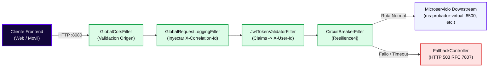

[⬅ Volver al README Principal](../../README.md)

---

## 2. ARQUITECTURA HEXAGONAL CON SUS DIAGRAMAS

El API Gateway está construido sobre **Spring Cloud Gateway** y **Project Reactor / Netty**. A diferencia de los servidores tradicionales basados en hilos dedicados por petición (Tomcat / Servlet API), Netty utiliza un modelo reactivo basado en EventLoop no bloqueante capaz de manejar miles de conexiones concurrentes con un consumo mínimo de memoria RAM y CPU.

### Diagramas del Componente

#### 2.1 Diagrama de Componentes General (Ecosistema StyleRadar)

  

Este diagrama presenta la visión arquitectónica global de StyleRadar y delimita el rol estratégico del **API Gateway** como frontera perimetral del sistema:

* **Punto Único de Entrada Perimetral (Single Point of Entry):** Todas las solicitudes emitidas desde la aplicación cliente (`StyleRadar Client Web App`) ingresan de forma obligatoria y exclusiva a través del **API Gateway** en el puerto `8080`. Ningún cliente externo posee visibilidad directa ni acceso a las direcciones IP o puertos de la red interna.
* **Ocultamiento de Topología Interna y Reverse Proxy:** El Gateway enruta el tráfico hacia el ecosistema de 13 microservicios autónomos bajo nomenclatura estandarizada:
  - **Paquete 1 (Identidad):** `ms-Auth` (:8100), `ms-Users` (:8120) y `ms-Stores` (:8140).
  - **Paquete 2 (Catálogo):** `ms-Inventory` (:8200), `ms-ItemCatalog` (:8220), `ms-Playlist` (:8260) y `ms-Geolocation` (:8240).
  - **Paquete 3 (Mensajería y Notificaciones):** `ms-Notifications` (:8300) y `ms-Chat` (:8320 con soporte WebSocket).
  - **Paquete 4 (Financiero y Analítica):** `ms-Payment` (:8400) y `ms-Statistics` (:8420).
  - **Paquete 5 (Experiencia y Moda Sostenible):** `ms-VirtualTryOn` (:8500) y `ms-Donations` (:8520).
  Gracias a este enrutamiento perimetral basado en contratos síncronos UML 2.5 (`API Gateway ---) (O--- ms-*`), los microservicios downstream pueden evolucionar, escalar o migrar de infraestructura interna sin impactar el contrato consumido por el frontend.
* **Naturaleza Stateless vs. Aislamiento de Persistencia (*Database-per-Service*):** Mientras los microservicios de negocio gestionan su propia base de datos relacional PostgreSQL de manera 100% aislada en 12 esquemas independientes (`users_db`, `stores_db`, `notifications_db`, `inventory_db`, `catalog_db`, `donations_db`, `chat_db`, `playlist_db`, `payments_db`, `geo_db`, `virtual_try_on_db` y `statistics_db`; `ms-Auth` no requiere base relacional al delegar sesiones en tokens y caché), el API Gateway es un componente **completamente sin estado (stateless)**. No persiste registros en disco ni compite por bloqueos de base de datos, lo que le permite maximizar el rendimiento reactivo no bloqueante de Netty y escalar horizontalmente bajo picos de tráfico masivo.
* **Aceleración en Memoria y Desacoplamiento Asíncrono:** Los microservicios consumen instancias de **Redis** para caching de alta velocidad (bases `Auth`, `Payment`, `Chat`, `Statistics` y `Virtual Try-on`) y colas dedicadas en **RabbitMQ** (`RabbitMQ Usuarios`, `RabbitMQ Notificaciones`, `RabbitMQ ItemCatalogo`, `RabbitMQ Pagos`, `RabbitMQ Geolocalizacion`, `RabbitMQ Estadisticas`) para procesamiento distribuido de eventos en segundo plano. El API Gateway opera en una capa superior a esta mensajería, procesando únicamente tráfico HTTP/WebSocket síncrono perimetral de alta concurrencia.
* **Frontera de Servicios Externos (SaaS):** Las integraciones de terceros (`Google OAuth` para identidad, `MercadoPago API` para pagos, `Azure Blob Storage` para activos multimedia y `FASHN AI API` para inferencia generativa) son consumidas internamente por los microservicios dueños de cada dominio. El Gateway actúa como escudo protector, evitando que llamadas externas no autorizadas puedan comprometer los conectores de infraestructura del sistema.

#### 2.2 Diagrama de Flujo y Cadena de Filtros Reactivos

Cada petición que cruza el Gateway atraviesa una tubería reactiva ordenada:
1. **`GlobalCorsFilter`:** Responde pre-flights `OPTIONS` y valida cabeceras permitidas.
2. **`GlobalRequestLoggingFilter`:** Garantiza la presencia de `X-Correlation-Id` y mide latencias de extremo a extremo.
3. **`JwtTokenValidatorFilter`:** Decodifica tokens Bearer JWT y propaga la identidad autenticada hacia los microservicios sin re-consultar bases de datos.
4. **`CircuitBreaker`:** Si el microservicio downstream no responde dentro del umbral temporal, intercepta la llamada y redirige hacia un endpoint de contingencia amigable.

#### 2.3 Diagrama de Secuencia de Enrutamiento, Validación JWT y Resiliencia

  

Este diagrama modela la interacción temporal del flujo de peticiones que cruzan el perímetro del Gateway:

* **Petición con Autenticación Bearer:** El cliente frontend envía una solicitud HTTP con token JWT. El Gateway intercepta la llamada en el puerto `8080`, ejecuta la cadena de filtros reactivos (`GlobalCorsFilter`, `GlobalRequestLoggingFilter` y `JwtTokenValidatorFilter`), sanea las cabeceras entrantes para neutralizar cualquier intento de spoofing (eliminando `X-User-Id`, `X-User-Role` y `X-User-Roles` que provengan del cliente) y valida la firma criptográfica HMAC-SHA256. Al comprobar su validez, inyecta downstream las cabeceras seguras `X-User-Id`, `X-User-Role` y `X-User-Roles` (reconstruidas estrictamente a partir de los claims del token verificado) junto al identificador de trazabilidad `X-Correlation-Id`.
* **Escenario de Éxito (Camino Saludable):** Si el microservicio downstream se encuentra en estado óptimo, procesa la solicitud y retorna una respuesta exitosa (por ejemplo, `HTTP 202 Accepted` en operaciones asíncronas), la cual es transferida de inmediato al cliente con sobrecarga mínima (< 5 ms).
* **Tolerancia a Fallos y Degeneración Elegante (Circuit Breaker con Resilience4j):** Si el microservicio de destino experimenta una caída de red, latencia excesiva o supera el umbral de fallos configurado, el Circuit Breaker de Resilience4j entra en estado abierto e intercepta la llamada, redirigiéndola hacia el `FallbackController` interno. El Gateway responde al usuario con un código `HTTP 503 Service Unavailable` formateado bajo el estándar RFC 7807 (Problem Details), protegiendo al ecosistema de fallos en cascada y garantizando una experiencia de usuario amigable.
* **Acceso Anónimo a Consultas Públicas vs Privadas:** Para las consultas de catálogo público (`GET /api/v1/second-hand`, `GET /api/v1/second-hand/*`, `GET /api/v1/second-hand/publications`, `GET /api/v1/second-hand/publications/*`, y sus equivalentes `/segunda-mano`), el Gateway permite el paso anónimo sin token. En contraste, las consultas privadas de donaciones (`GET /api/v1/donations/**`, `GET /api/v1/donaciones/**`), las consultas privadas por usuario (`GET /api/v1/second-hand/publications/users/**`, `GET /api/v1/second-hand/user/**`, y equivalentes) y todas las operaciones mutantes (`POST`, `PUT`, `PATCH`, `DELETE`) exigen estrictamente autenticación Bearer, neutralizando cualquier intento de inyección de cabeceras (`X-User-Id`, `X-User-Role`, `X-User-Roles`) y rechazando accesos no autorizados con `HTTP 401 Unauthorized`.

#### 2.4 Diagrama de Despliegue General (Infraestructura de Contenedores y Topología de Red)

  
  
<b>Figura 2.4:</b> Topología física de despliegue en la nube (Microsoft Azure PaaS / Docker OCI) evidenciando el aislamiento perimetral del API Gateway como único punto de Ingress público hacia la red confinada de microservicios.

Este diagrama modela la topología física, el confinamiento de red y la arquitectura de infraestructura en la nube para la solución integral **StyleRadar**, destacando la posición estratégica del **API Gateway** como centinela de seguridad perimetral:

* **1. Zona de Cliente y Acceso Público (`«Device» Client / User Device`):**
  - Los usuarios compradores, comercios aliados y administradores acceden al sistema a través de su navegador web (`«Execution Environment» Web Browser`), el cual ejecuta el artefacto cliente `«Artifact» Web Application (React / Vite)`.
  - Todo el tráfico cliente viaja de forma obligatoria y cifrada a través de protocolos seguros **`HTTPS :443`** (para llamadas HTTP REST) y **`WSS :8080`** (WebSockets reactivos) hacia el puerto público `:8080` del **API Gateway**.
  - Ningún cliente exterior conoce ni puede alcanzar directamente las IPs privadas ni los puertos internos de la malla de microservicios.

* **2. Entorno de Ejecución en Contenedores (`«Execution Environment» Azure Container Apps Environment`):**
  - **`«Container App» API Gateway :8080`:** Es el **único contenedor con Ingress público expuesto** (`:8080`) en todo el entorno en la nube. Asume la terminación TLS, la negociación de políticas CORS (`GlobalCorsFilter`), la inyección de correlación y telemetría (`GlobalRequestLoggingFilter`), y el control estricto de autenticación perimetral (`JwtTokenValidatorFilter`).
  - **Malla de 13 Microservicios (`«Container App»`):** Residen en una red confinada privada sin exposición pública, comunicándose con el API Gateway mediante enlaces HTTP síncronos directos en sus respectivos puertos:
    - **`ms-Auth :8100`** (`HTTP :8100`) — Autenticación federada, emisión y validación de tokens.
    - **`ms-Users :8120`** (`HTTP :8120`) — Gestión de perfiles, roles y medidas biométricas.
    - **`ms-Stores :8140`** (`HTTP :8140`) — Gestión de comercios aliados y catálogos de tiendas.
    - **`ms-Inventory :8200`** (`HTTP :8200`) — Control de existencias de prendas y stock en tiempo real.
    - **`ms-Playlist :8260`** (`HTTP :8260`) — Playlists de moda, tendencias y recomendaciones.
    - **`ms-Geolocation :8240`** (`HTTP :8240`) — Localización geográfica de tiendas y cálculo de cercanía.
    - **`ms-Chat :8320`** (`HTTP :8320`) — Mensajería interactiva cliente-comercio.
    - **`ms-Statistics :8420`** (`HTTP :8420`) — Métricas de interacción, telemetría y analítica de negocio.
    - **`ms-ItemCatalog :8220`** (`HTTP :8220`) — Fichas técnicas de prendas y prendas disponibles.
    - **`ms-VirtualTryOn :8500`** (`HTTP :8500`) — Orquestación de probador virtual con IA generativa y cuotas.
    - **`ms-Payment :8400`** (`HTTP :8400`) — Pasarela de cobros, suscripciones y transacciones.
    - **`ms-Donations :8520`** (`HTTP :8520`) — Gestión de donaciones de ropa y economía circular *(puerto diferenciado, resolviendo colisiones previas)*.
    - **`ms-Notifications :8300`** (`HTTP :8300`) — Notificaciones push y correos transaccionales.

* **3. Persistencia Relacional Dedicada (`«Execution Environment» Azure Database for PostgreSQL` · `:5432`):**
  - Siguiendo el patrón *Database-per-Service*, un servidor PostgreSQL gestionado aloja **12 bases de datos lógicas independientes** conectadas mediante **`TCP :5432`**:
    `users_db`, `stores_db`, `notifications_db`, `inventory_db`, `catalog_db`, `donations_db`, `chat_db`, `playlist_db`, `payments_db`, `geo_db`, `virtual_try_on_db` y `statistics_db`.
  - Cada microservicio con persistencia relacional accede estrictamente a su base de datos asignada. `ms-Auth` no requiere base de datos relacional al gestionar sesiones en caché y validar tokens criptográficos.

* **4. Aceleración en Memoria (`«Execution Environment» Azure Cache for Redis` · `:6379`):**
  - Clúster en memoria conectado mediante protocolo **`RESP :6379`** por los microservicios con requerimientos de latencia ultrabaja:
    - `ms-Auth` (sesiones y blacklist de tokens)
    - `ms-Payment` (idempotencia transaccional y bloqueos de cobro)
    - `ms-Chat` (presencia y estados de conexión)
    - `ms-Statistics` (contadores en tiempo real)
    - `ms-VirtualTryOn` (cuotas de usuario y bloqueos de renderizado)

* **5. Broker de Mensajería Asíncrona (`«Execution Environment» RabbitMQ Message Broker` · `:5672`):**
  - Servidor de mensajería conectado mediante protocolo **`AMQP :5672`** con los **13 microservicios**, orquestando la publicación y consumo desacoplado de eventos del dominio sin sobrecargar la capa síncrona del Gateway.

* **6. Proveedores y Servicios Externos en la Nube (SaaS · `HTTPS :443`):**
  - **`Google OAuth 2.0` (`«External System»`):** Consumido por `ms-Auth` para inicio de sesión federado.
  - **`Azure Blob Storage` (`«Cloud Service»`):** Consumido por `ms-Stores`, `ms-Donations` y `ms-VirtualTryOn` para almacenamiento seguro de imágenes.
  - **`FASHN AI` (`«External AI API»`):** Consumido por `ms-VirtualTryOn` para inferencia generativa neuronal de prendas.
  - **`Mercado Pago API` (`«External System»`):** Consumido por `ms-Payment` para procesamiento de pagos y suscripciones.

---

[⬅ Volver al README Principal](../../README.md)
