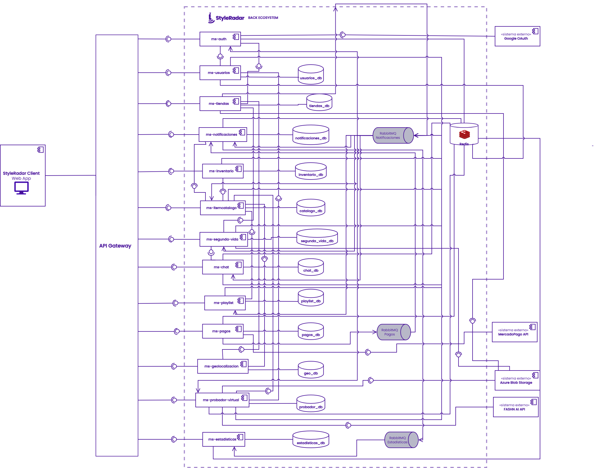
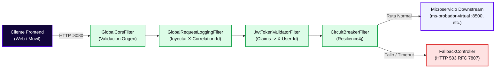
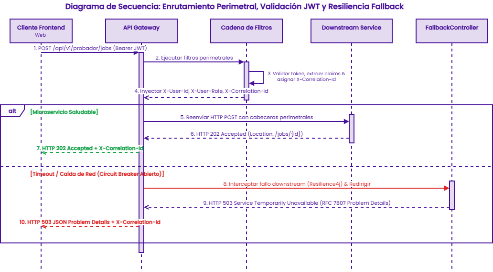
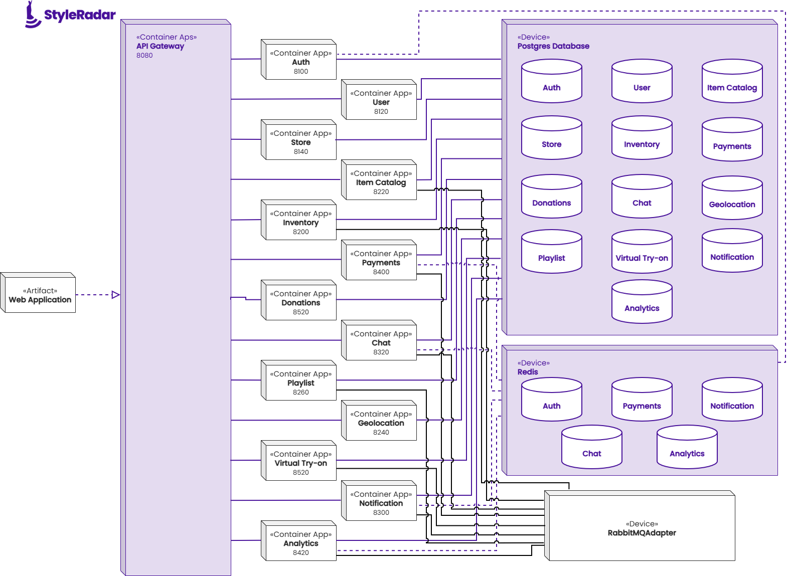

[⬅ Volver al README Principal](../../README.md)

---

## 2. ARQUITECTURA HEXAGONAL CON SUS DIAGRAMAS

El API Gateway está construido sobre **Spring Cloud Gateway** y **Project Reactor / Netty**. A diferencia de los servidores tradicionales basados en hilos dedicados por petición (Tomcat / Servlet API), Netty utiliza un modelo reactivo basado en EventLoop no bloqueante capaz de manejar miles de conexiones concurrentes con un consumo mínimo de memoria RAM y CPU.

### Diagramas del Componente

#### 2.1 Diagrama de Componentes General (Ecosistema StyleRadar)

  

Este diagrama presenta la visión arquitectónica global de StyleRadar y delimita el rol estratégico del **API Gateway** como frontera perimetral del sistema:

* **Punto Único de Entrada Perimetral (Single Point of Entry):** Todas las solicitudes emitidas desde la aplicación cliente (`StyleRadar Client Web App`) ingresan de forma obligatoria y exclusiva a través del **API Gateway** en el puerto `8080`. Ningún cliente externo posee visibilidad directa ni acceso a las direcciones IP o puertos de la red interna.
* **Ocultamiento de Topología Interna y Reverse Proxy:** El Gateway enruta el tráfico hacia el ecosistema de 13 microservicios (`ms-auth` en `:8100`, `ms-usuarios` en `:8120`, `ms-tiendas` en `:8140`, `ms-notificaciones` en `:8300`, `ms-inventario` en `:8200`, `ms-itemcatalogo` en `:8220`, `ms-segunda-vida` en `:8280`, `ms-chat` en `:8320`, `ms-playlist` en `:8260`, `ms-pagos` en `:8400`, `ms-geolocalizacion` en `:8240`, `ms-probador-virtual` en `:8500` y `ms-estadisticas` en `:8420`). Gracias a este enrutamiento perimetral, los microservicios downstream pueden evolucionar, escalar o cambiar de dirección interna sin impactar el contrato consumido por el frontend.
* **Naturaleza Stateless vs. Aislamiento de Persistencia (*Database-per-Service*):** Mientras cada microservicio de negocio gestiona su propia base de datos relacional PostgreSQL de manera 100% aislada (`usuarios_db`, `tiendas_db`, `catalogo_db`, `probador_db`, etc.), el API Gateway es un componente **completamente sin estado (stateless)**. No persiste registros en disco ni compite por bloqueos de base de datos, lo que le permite maximizar el rendimiento reactivo no bloqueante de Netty y escalar horizontalmente bajo picos de tráfico masivo.
* **Aceleración en Memoria y Desacoplamiento Asíncrono:** Los microservicios consumen instancias de **Redis** para caching de alta velocidad y colas en **RabbitMQ** para procesamiento de eventos en segundo plano (notificaciones, analítica, transacciones). El API Gateway opera en una capa superior a esta mensajería, procesando únicamente tráfico HTTP/WebSocket síncrono perimetral de alta concurrencia.
* **Frontera de Servicios Externos (SaaS):** Las integraciones de terceros (Google OAuth, MercadoPago API, Azure Blob Storage y FASHN AI API) son consumidas internamente por los microservicios dueños de cada dominio. El Gateway actúa como escudo protector, evitando que llamadas externas no autorizadas puedan comprometer los conectores de infraestructura del sistema.

#### 2.2 Diagrama de Flujo y Cadena de Filtros Reactivos

Cada petición que cruza el Gateway atraviesa una tubería reactiva ordenada:
1. **`GlobalCorsFilter`:** Responde pre-flights `OPTIONS` y valida cabeceras permitidas.
2. **`GlobalRequestLoggingFilter`:** Garantiza la presencia de `X-Correlation-Id` y mide latencias de extremo a extremo.
3. **`JwtTokenValidatorFilter`:** Decodifica tokens Bearer JWT y propaga la identidad autenticada hacia los microservicios sin re-consultar bases de datos.
4. **`CircuitBreaker`:** Si el microservicio downstream no responde dentro del umbral temporal, intercepta la llamada y redirige hacia un endpoint de contingencia amigable.

#### 2.3 Diagrama de Secuencia de Enrutamiento, Validación JWT y Resiliencia

  

Este diagrama modela la interacción temporal del flujo de peticiones que cruzan el perímetro del Gateway:

* **Petición con Autenticación Bearer:** El cliente frontend envía una solicitud HTTP con token JWT. El Gateway intercepta la llamada en el puerto `8080`, ejecuta la cadena de filtros reactivos (`GlobalCorsFilter`, `GlobalRequestLoggingFilter` y `JwtTokenValidatorFilter`), sanea las cabeceras entrantes para neutralizar cualquier intento de spoofing (eliminando `X-User-Id`, `X-User-Role` y `X-User-Roles` que provengan del cliente) y valida la firma criptográfica HMAC-SHA256. Al comprobar su validez, inyecta downstream las cabeceras seguras `X-User-Id`, `X-User-Role` y `X-User-Roles` (reconstruidas estrictamente a partir de los claims del token verificado) junto al identificador de trazabilidad `X-Correlation-Id`.
* **Escenario de Éxito (Camino Saludable):** Si el microservicio downstream se encuentra en estado óptimo, procesa la solicitud y retorna una respuesta exitosa (por ejemplo, `HTTP 202 Accepted` en operaciones asíncronas), la cual es transferida de inmediato al cliente con sobrecarga mínima (< 5 ms).
* **Tolerancia a Fallos y Degeneración Elegante (Circuit Breaker con Resilience4j):** Si el microservicio de destino experimenta una caída de red, latencia excesiva o supera el umbral de fallos configurado, el Circuit Breaker de Resilience4j entra en estado abierto e intercepta la llamada, redirigiéndola hacia el `FallbackController` interno. El Gateway responde al usuario con un código `HTTP 503 Service Unavailable` formateado bajo el estándar RFC 7807 (Problem Details), protegiendo al ecosistema de fallos en cascada y garantizando una experiencia de usuario amigable.
* **Acceso Anónimo a Consultas Públicas vs Privadas:** Para las consultas de catálogo público (`GET /api/v1/second-hand`, `GET /api/v1/second-hand/*`, `GET /api/v1/second-hand/publications`, `GET /api/v1/second-hand/publications/*`, y sus equivalentes `/segunda-mano`), el Gateway permite el paso anónimo sin token. En contraste, las consultas privadas de donaciones (`GET /api/v1/donations/**`, `GET /api/v1/donaciones/**`), las consultas privadas por usuario (`GET /api/v1/second-hand/publications/users/**`, `GET /api/v1/second-hand/user/**`, y equivalentes) y todas las operaciones mutantes (`POST`, `PUT`, `PATCH`, `DELETE`) exigen estrictamente autenticación Bearer, neutralizando cualquier intento de inyección de cabeceras (`X-User-Id`, `X-User-Role`, `X-User-Roles`) y rechazando accesos no autorizados con `HTTP 401 Unauthorized`.

#### 2.4 Diagrama de Despliegue General (Infraestructura de Contenedores y Topología de Red)

  
  
<b>Figura 2.4:</b> Topología física de despliegue en la nube (Microsoft Azure PaaS / Docker OCI) evidenciando el aislamiento perimetral del API Gateway como único punto de Ingress público hacia la red confinada de microservicios.

Este diagrama modela la topología física, el confinamiento de red y la arquitectura de infraestructura en la nube para la solución integral **StyleRadar**, destacando la posición estratégica del **API Gateway** como centinela de seguridad perimetral:

* **1. Zona Pública / DMZ y Clientes Externos (`«device» Client Workstation / Mobile`):**
  - Los usuarios compradores, almacenes aliados, fundaciones y administradores acceden al sistema desde navegadores web (SPA React alojada en Vercel) y aplicaciones móviles (Android / iOS).
  - Todo el tráfico cliente viaja obligatoriamente a través de conexiones seguras cifradas con **HTTPS / TLS 1.3** hacia el nombre de dominio oficial o endpoint de Azure App Service (`:8080`).
  - Ningún cliente exterior conoce ni puede alcanzar directamente las IPs privadas ni los puertos de los microservicios de negocio.

* **2. Perímetro de Entrada e Ingress Público (`«container» api-gateway`):**
  - El **API Gateway** se ejecuta como un contenedor OCI basado en `eclipse-temurin:21-jre-alpine` bajo el proceso no privilegiado `gateway (UID 10001)`.
  - Es el **único contenedor con Ingress público expuesto** (puerto `8080`) en todo el entorno en la nube (`StyleRadar Cloud Environment`).
  - Asume la terminación TLS, la negociación de políticas CORS (`GlobalCorsFilter`), la inyección de correlación y telemetría (`GlobalRequestLoggingFilter`), y el control estricto de autenticación perimetral (`JwtTokenValidatorFilter`).
  - Cuenta con mitigación activa frente a la vulnerabilidad CVE-2025-41243 (endpoint administrativo `/actuator/gateway` completamente deshabilitado y protegido).
  - La sonda de salud de Azure PaaS (`Liveness/Readiness Probe`) supervisa el contenedor cada 30 segundos a través de `/actuator/health`.

* **3. Malla Confinada de Microservicios (`«network» styleradar-network / Azure VNet`):**
  - Los 13 microservicios residen en una red virtual privada y aislada (Azure VNet / Docker Bridge confinada), sin mapeo de puertos hacia la interfaz pública del Host.
  - La comunicación entre el Gateway y los microservicios downstream es directa, interna y de ultra-baja latencia (< 5 ms):
    - **Paquete 1: Identidad (CADche · Bloque 8100):** `ms-auth` (:8100), `ms-usuarios` (:8120) y `ms-tiendas` (:8140).
    - **Paquete 2: Catálogo (RESTrepo · Bloque 8200):** `ms-inventario` (:8200), `ms-item-catalogo` (:8220), `ms-geolocalizacion` (:8240) y `ms-playlist` (:8260).
    - **Paquete 3: Mensajería y Notificaciones (Guatoque · Bloque 8300):** `ms-notificaciones` (:8300) y `ms-chat` (:8320 con soporte WebSocket/STOMP).
    - **Paquete 4: Pagos y Analítica (NQS · Bloque 8400):** `ms-pagos-suscripciones` (:8400) y `ms-estadisticas` (:8420).
    - **Paquete 5: Experiencia y Moda Sostenible (Portal 8080 · Bloque 8500):** `ms-probador-virtual` (:8500) y `ms-segunda-vida-donaciones` (:8520).
  - Los circuitos de falla de Resilience4j protegen al Gateway de microservicios con lentitud o caídas, degradando elegantemente hacia el `FallbackController` interno (`HTTP 503 RFC 7807`).

* **4. Desacoplamiento de Persistencia (*Database-per-Service*) y Asincronía:**
  - Siguiendo los principios de microservicios limpios, cada componente posee su propia base de datos relacional independiente en **Azure Database for PostgreSQL** (`auth_db`, `usuarios_db`, `tiendas_db`, `catalogo_db`, `probador_db`, `donaciones_db`, etc.). Está estrictamente prohibido el acceso cruzado entre esquemas.
  - **Redis** provee almacenamiento en memoria para sesiones, contadores en tiempo real y candados de concurrencia e idempotencia.
  - **RabbitMQ / Kafka** orquesta los eventos asíncronos desacoplados (`StockChangedEvent`, `PagoConfirmadoEvent`, `DonationStatusEvent`).
  - **Naturaleza 100% Stateless del Gateway:** Al no poseer base de datos propia ni conexiones directas a los brokers de eventos, el Gateway mantiene una huella de memoria ultraligera (~150 MB de RAM), arranques en frío en menos de 3 segundos y capacidad de autoscaling horizontal elástico inmediato ante variaciones de demanda.

* **5. Frontera Segura con Proveedores SaaS:**
  - Los proveedores externos de software como servicio (**Azure Blob Storage** para almacenamiento de imágenes, **Google Identity** para OAuth2, **Mercado Pago** para pasarela de pagos y **FASHN AI** para generación generativa VTON) son consumidos exclusivamente desde los microservicios especializados de backend.
  - Esta topología garantiza que el Gateway jamás almacene credenciales de terceros ni exponga claves de API de servicios externos en sus capas perimetrales.

---

[⬅ Volver al README Principal](../../README.md)
