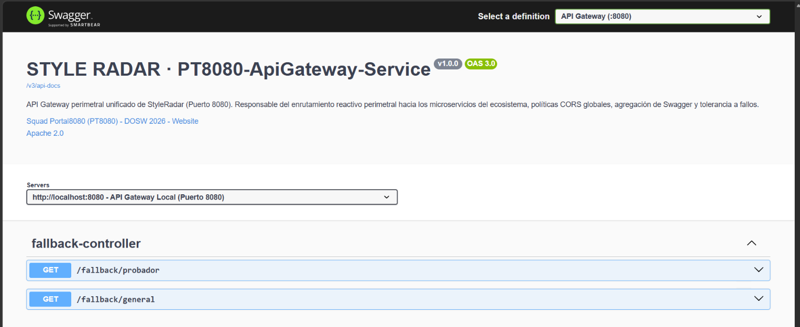

[⬅ Volver al README Principal](../../README.md)

---

## 3. ENDPOINTS Y ENLACE A SWAGGER

### Matriz Oficial de Enlaces por Entorno (PROD, QA, LOCAL)

| Entorno | Estado | Propósito | URL Base del Gateway | Swagger Agregado | Health Check |
| :--- | :---: | :--- | :--- | :--- | :--- |
| **Desarrollo Local (DEV)** | 🟢 **Active** | Entorno local de desarrollo y Docker Compose | `http://localhost:8080` | [Swagger UI Local](http://localhost:8080/swagger-ui.html) | [`/actuator/health`](http://localhost:8080/actuator/health) |
| **Calidad / Pruebas (QA)** | 🟢 **Active** | Pruebas integradas perimetrales en Azure PaaS | `https://styleradar-gateway-qa.azurewebsites.net` | [Swagger UI QA](https://styleradar-gateway-qa.azurewebsites.net/swagger-ui.html) | [`/actuator/health`](https://styleradar-gateway-qa.azurewebsites.net/actuator/health) |
| **Producción (PROD)** | 🟢 **Active** | Despliegue perimetral productivo en Azure PaaS | `https://styleradar-gateway-prod.azurewebsites.net` | [Swagger UI PROD](https://styleradar-gateway-prod.azurewebsites.net/swagger-ui.html) | [`/actuator/health`](https://styleradar-gateway-prod.azurewebsites.net/actuator/health) |

### Tabla Oficial de Enrutamiento Hacia los 13 Microservicios de StyleRadar

> [!IMPORTANT]
> **Resolución de Conflictos y Orden de Precedencia en Rutas de Almacenes (`/api/v1/almacenes/**`):**
> Para evitar que peticiones especializadas sean interceptadas erróneamente por la ruta comodín de Tiendas, Spring Cloud Gateway evalúa las rutas mediante el atributo de precedencia `order`:
> 1. **`ms-geolocalizacion-almacenes` (`order: -2`):** Evalúa con alta prioridad las peticiones `GET` a `/api/v1/almacenes`, `/api/v1/almacenes/{id}/distancia` y `/api/v1/fundaciones/cercanas`, dirigiéndolas al motor de cálculo geográfico en el puerto `8240`.
> 2. **`ms-item-catalogo-almacenes` (`order: -2`):** Evalúa con alta prioridad las peticiones `GET` a `/api/v1/almacenes/{id}/catalogo` y sus variantes `/resumen` y `/novedades`, dirigiéndolas al microservicio de Catálogo en el puerto `8220`.
> 3. **`ms-tiendas` (orden por defecto):** Atiende las demás operaciones coincidentes con `/api/v1/almacenes/**` (gestión de la entidad tienda, creación, actualización), junto con `/api/v1/admin/stores/**` y `/api/v1/admin/foundations/**`.

| Microservicio | Paquete / Squad | Puerto Oficial | Prefijo de Ruta Expuesto | Circuit Breaker Activo | Host QA (Azure) | Host PROD (Azure) |
| :--- | :--- | :---: | :--- | :---: | :--- | :--- |
| `ms-auth` | P1: Identidad | `8100` | `/api/v1/auth/**` | No (Paso directo) | `styleradar-auth-qa` | `styleradar-auth-prod` |
| `ms-geolocalizacion` | P2: Catálogo | `8240` | `/api/v1/geolocalizacion/**`, `/api/v1/geolocation/**` *(Prioridad `order: -2`)*: `GET /api/v1/almacenes`, `GET /api/v1/almacenes/{id}/distancia`, `GET /api/v1/fundaciones/cercanas` | No (Paso directo) | `styleradar-geolocalizacion-qa` | `styleradar-geolocalizacion-prod` |
| `ms-item-catalogo` | P2: Catálogo | `8220` | `/api/v1/catalogo/**`, `/api/v1/prendas/**`, `/api/v1/catalog/**`, `/api/v1/items/**` *(Prioridad `order: -2`)*: `GET /api/v1/almacenes/{id}/catalogo`, `GET /api/v1/almacenes/{id}/catalogo/resumen`, `GET /api/v1/almacenes/{id}/novedades` | No (Paso directo) | `styleradar-catalogo-qa` | `styleradar-catalogo-prod` |
| `ms-tiendas` | P1: Identidad | `8140` | `/api/v1/stores/**`, `/api/v1/foundations/**`, `/api/v1/tiendas/**`, `/api/v1/admin/stores/**`, `/api/v1/admin/foundations/**` *(Precedencia general)*: demás rutas coincidentes con `/api/v1/almacenes/**` | No (Paso directo) | `styleradar-tiendas-qa` | `styleradar-tiendas-prod` |
| `ms-usuarios` | P1: Identidad | `8120` | `/api/v1/usuarios/**`, `/api/v1/admin/usuarios/**`, `/api/v1/admin/**` | No (Paso directo) | `styleradar-qa-app` | `styleradar-prod-app` |
| `ms-inventario` | P2: Catálogo | `8200` | `/api/v1/inventario/**`, `/api/v1/inventory/**` | No (Paso directo) | `styleradar-inventario-qa` | `styleradar-inventario-prod` |
| `ms-playlist` | P2: Catálogo | `8260` | `/api/v1/playlist/**`, `/api/v1/playlists/**` | No (Paso directo) | `styleradar-playlist-qa` | `styleradar-playlist-prod` |
| `ms-notificaciones` | P3: Mensajería | `8300` | `/api/v1/notificaciones/**`, `/api/v1/notifications/**`, `/api/v1/usuarios/*/notificaciones/**`, `/api/v1/users/*/notifications/**` | No (Paso directo) | `styleradar-notificaciones-qa` | `styleradar-notificaciones-prod` |
| `ms-chat` | P3: Mensajería | `8320` | **HTTP:** `/api/v1/conversations/**`, `/api/v1/conversaciones/**`, `/api/v1/chat/**` **WebSocket (ms-chat-ws):** `/ws`, `/ws/**`, `/ws-chat`, `/ws-chat/**` (`ws://localhost:8320`) | No (Paso directo) | `gj-chat-service-qa-santi-gxhjccffcxdgbfcj` | `gj-chat-service-prod-santi` |
| `ms-pagos-suscripciones` | P4: Pagos | `8400` | `/api/v1/pagos/**`, `/api/v1/payments/**`, `/api/v1/subscriptions/**`, `/api/v1/suscripciones/**`, `/api/v1/planes/**`, `/api/v1/webhooks/**`, `/api/v1/admin/pagos/**` | No (Paso directo) | `styleradar-pagos-qa` | `styleradar-pagos-prod` |
| `ms-estadisticas` | P4: Pagos | `8420` | `/api/v1/estadisticas/**`, `/api/v1/statistics/**`, `/api/v1/analytics/**` | No (Paso directo) | `styleradar-estadisticas-qa` | `styleradar-estadisticas-prod` |
| `ms-probador-virtual` | P5: Experiencia | `8500` | `/api/v1/try-on/**`, `/api/v1/probador/**` | Sí (`/fallback/probador`) | `styleradar-virtualtryon-qa` | `styleradar-virtualtryon-prod` |
| `ms-segunda-vida-donaciones` | P5: Experiencia | `8520` | `/api/v1/health`, `/api/v1/donations/**`, `/api/v1/second-hand/**`, `/api/v1/donaciones/**`, `/api/v1/segunda-mano/**` | Sí (`/fallback/general`) | `styleradar-donaciones-qa-jmunar` | `styleradar-donaciones-prod-jmunar` |
| `api-gateway` | Perímetro | `8080` | `/actuator/**`, `/v3/api-docs`, `/swagger-ui.html` | N/A | `styleradar-gateway-qa` | `styleradar-gateway-prod` |

### Enrutamiento y Agregación OpenAPI / Swagger (`/v3/api-docs/*`)

El Gateway expone un catálogo Swagger agregado en `http://localhost:8080/swagger-ui.html` que consolida las especificaciones OpenAPI de los microservicios downstream mediante reescrituras de ruta transparentes (`SetPath`):

| Selector Swagger UI | Ruta Expuesta en Gateway | Reescritura Interna (`SetPath`) | Servicio Destino | Puerto |
| :--- | :--- | :--- | :--- | :---: |
| **API Gateway (:8080)** | `/v3/api-docs` | N/A (Especificación local) | `api-gateway` | `8080` |
| **ms-probador-virtual (:8500)** | `/v3/api-docs/probador` | $\to$ `/v3/api-docs` | `ms-probador-virtual` | `8500` |
| **ms-segunda-vida-donaciones (:8520)** | `/v3/api-docs/donaciones`, `/v3/api-docs/donations` | $\to$ `/api/v1/v3/api-docs` | `ms-segunda-vida-donaciones` | `8520` |
| **ms-auth (:8100)** | `/v3/api-docs/auth` | $\to$ `/v3/api-docs` | `ms-auth` | `8100` |
| **ms-tiendas (:8140)** | `/v3/api-docs/tiendas` | $\to$ `/v3/api-docs` | `ms-tiendas` | `8140` |
| **ms-notificaciones (:8300)** | `/v3/api-docs/notificaciones` | $\to$ `/v3/api-docs` | `ms-notificaciones` | `8300` |
| **ms-usuarios (:8120)** | `/v3/api-docs/usuarios` | $\to$ `/v3/api-docs` | `ms-usuarios` | `8120` |
| **ms-chat (:8320)** | `/v3/api-docs/chat` | $\to$ `/v3/api-docs` | `ms-chat` | `8320` |

### Tabla Oficial de Despliegue y Bases de Datos por Ambiente (Rúbrica Sprint 2)

> **Regla de Oro de la Cátedra:** QA y PROD nunca comparten base de datos. El API Gateway es un componente puramente stateless y reactivo sobre Netty, por lo que opera sin base de datos propia.

| Servicio | URL QA | URL PROD | BD QA | BD PROD |
| :--- | :--- | :--- | :---: | :---: |
| `api-gateway` | `https://styleradar-gateway-qa.azurewebsites.net` | `https://styleradar-gateway-prod.azurewebsites.net` | N/A (Stateless) | N/A (Stateless) |
| `ms-probador-virtual` | `https://styleradar-virtualtryon-qa.azurewebsites.net` | `https://styleradar-virtualtryon-prod.azurewebsites.net` | `probador_db_qa` | `probador_db_prod` |
| `ms-segunda-vida-donaciones` | `https://styleradar-donaciones-qa-jmunar.azurewebsites.net` | `https://styleradar-donaciones-prod-jmunar.azurewebsites.net` | `donaciones_db_qa` | `donaciones_db_prod` |
| `ms-auth` | `https://styleradar-auth-qa.azurewebsites.net` | `https://styleradar-auth-prod.azurewebsites.net` | `auth_db_qa` | `auth_db_prod` |
| `ms-usuarios` | `https://styleradar-qa-app.azurewebsites.net` | `https://styleradar-prod-app.azurewebsites.net` | `usuarios_db_qa` | `usuarios_db_prod` |
| `ms-tiendas` | `https://styleradar-tiendas-qa.azurewebsites.net` | `https://styleradar-tiendas-prod.azurewebsites.net` | `tiendas_db_qa` | `tiendas_db_prod` |
| `ms-inventario` | `https://styleradar-inventario-qa.azurewebsites.net` | `https://styleradar-inventario-prod.azurewebsites.net` | `inventario_db_qa` | `inventario_db_prod` |
| `ms-item-catalogo` | `https://styleradar-catalogo-qa.azurewebsites.net` | `https://styleradar-catalogo-prod.azurewebsites.net` | `catalogo_db_qa` | `catalogo_db_prod` |
| `ms-geolocalizacion` | `https://styleradar-geolocalizacion-qa.azurewebsites.net` | `https://styleradar-geolocalizacion-prod.azurewebsites.net` | `geolocalizacion_db_qa` | `geolocalizacion_db_prod` |
| `ms-playlist` | `https://styleradar-playlist-qa.azurewebsites.net` | `https://styleradar-playlist-prod.azurewebsites.net` | `playlist_db_qa` | `playlist_db_prod` |
| `ms-notificaciones` | `https://styleradar-notificaciones-qa.azurewebsites.net` | `https://styleradar-notificaciones-prod.azurewebsites.net` | `notificaciones_db_qa` | `notificaciones_db_prod` |
| `ms-chat` | `https://gj-chat-service-qa-santi-gxhjccffcxdgbfcj.canadacentral-01.azurewebsites.net` | `https://gj-chat-service-prod-santi.azurewebsites.net` | `chat_db_qa` | `chat_db_prod` |
| `ms-pagos-suscripciones` | `https://styleradar-pagos-qa.azurewebsites.net` | `https://styleradar-pagos-prod.azurewebsites.net` | `pagos_db_qa` | `pagos_db_prod` |
| `ms-estadisticas` | `https://styleradar-estadisticas-qa.azurewebsites.net` | `https://styleradar-estadisticas-prod.azurewebsites.net` | `estadisticas_db_qa` | `estadisticas_db_prod` |

### Evidencia de Swagger OpenAPI UI Activa

  
  
<b>Figura 3.1:</b> Documentación interactiva Swagger OpenAPI UI activa en <code>http://localhost:8080/swagger-ui.html</code> evidenciando contratos OpenAPI 3.0 agregados del API Gateway y respuestas de fallback bajo estándar RFC 7807.

---

[⬅ Volver al README Principal](../../README.md)
