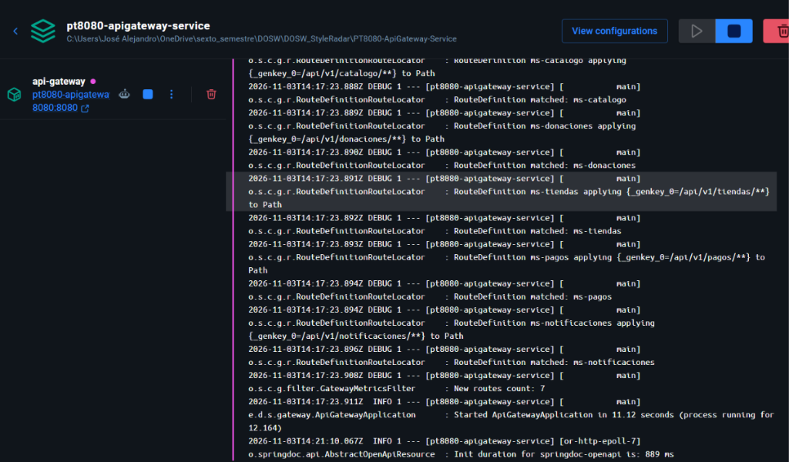

[⬅ Volver al README Principal](../../README.md)

---

## 6. CÓMO EJECUTAR LOCAL Y CON DOCKER

### Prerrequisitos de Entorno

* **Java Development Kit (JDK):** Versión 21 LTS instalada (`java -version`).
* **Apache Maven:** Versión 3.9+ o uso del wrapper incluido `./mvnw`.
* **Docker Engine & Docker Compose:** Versión 24+ en ejecución (`docker --version`).

### Ejecución Local con Maven

```bash
# 1. Clonar el repositorio
git clone https://github.com/StyleRadar1/PT8080-ApiGateway-Service.git
cd PT8080-ApiGateway-Service

# 2. Ejecutar el Gateway localmente en el puerto 8080
./mvnw clean spring-boot:run -Dspring-boot.run.profiles=dev
```

### Ejecución Contenerizada con Docker Compose

> [!WARNING]
> **Alcance de Docker Compose en este Repositorio:**
> El comando `docker compose up -d --build` en este repositorio levanta **únicamente el contenedor perimetral del API Gateway (`sr-api-gateway`)**. 
> Que el Gateway responda `{"status":"UP"}` en su healthcheck perimetral confirma que el servidor Netty está operando, **pero no implica que los microservicios downstream estén conectados o accesibles**. Para probar el enrutamiento real hacia los microservicios, cada backend debe ser accesible desde dentro del contenedor.

```bash
# 1. Levantar el contenedor del API Gateway en segundo plano
docker compose up -d --build

# 2. Verificar estado y salud del contenedor
docker compose ps

# 3. Ver logs en tiempo real del Gateway
docker compose logs -f api-gateway

# 4. Detener el servicio
docker compose down
```

### Conexión del Gateway con los Microservicios en Docker

Para que el contenedor del Gateway pueda resolver y comunicarse con los demás microservicios del ecosistema StyleRadar:

1. **Red Compartida (`styleradar-network`):**  
   El Gateway crea y opera sobre una red bridge dedicada llamada `styleradar-network`. Todos los contenedores de los microservicios deben pertenecer a esta misma red.
   - Si levantas un microservicio desde su propio repositorio, asegúrate de conectarlo a la red:
     ```bash
     # Conectar un contenedor ya existente a la red del Gateway:
     docker network connect styleradar-network <nombre-o-id-del-contenedor>
     ```
   - O bien, en el `docker-compose.yml` del microservicio respectivo:
     ```yaml
     networks:
       default:
         name: styleradar-network
         external: true
     ```

2. **Resolución DNS Interna de Contenedores:**  
   Dentro de la red Docker, el Gateway resuelve los destinos por su nombre de servicio DNS. Los valores predeterminados en este `docker-compose.yml` apuntan a:
   - `AUTH_SERVICE_URL`: `http://ms-auth:8081`
   - `CATALOGO_SERVICE_URL`: `http://ms-catalogo:8084`
   - `TIENDAS_SERVICE_URL`: `http://ms-tiendas:8082`
   - `NOTIFICACIONES_SERVICE_URL`: `http://ms-notificaciones:8091`
   - `PAGOS_SERVICE_URL`: `http://ms-pagos:8090`
   - `TRYON_SERVICE_URL`: `http://sr-probador-virtual:8500`
   - `DONACIONES_SERVICE_URL`: `http://ms-donaciones:8520`

3. **Sobrescritura de URLs (`*_SERVICE_URL`):**  
   Si el equipo ejecuta un microservicio con un nombre de contenedor o puerto interno distinto, debe sobrescribir la variable correspondiente antes de levantar el Gateway o mediante el archivo `.env`:
   ```bash
   # Opción A: Sobrescritura inline en la terminal
   AUTH_SERVICE_URL=http://mi-auth-custom:8100 docker compose up -d

   # Opción B: Si un microservicio corre directamente en el host (fuera de Docker)
   # se utiliza host.docker.internal para alcanzar el localhost del host:
   TRYON_SERVICE_URL=http://host.docker.internal:8500 docker compose up -d
   ```

4. **Verificación de Enrutamiento Extremo a Extremo:**  
   Una vez conectado el servicio, prueba que el Gateway redirija correctamente la petición hacia el backend:
   ```bash
   # Probar enrutamiento hacia Probador Virtual
   curl -i http://localhost:8080/api/v1/try-on/health

   # Probar enrutamiento hacia Catálogo
   curl -i http://localhost:8080/api/v1/catalogo
   ```

### Evidencia de Contenedor OCI en Ejecución (Docker Desktop & Logs)

<div align="center">
  
  <p><sub><b>Figura 6.1:</b> Ejecución contenerizada en Docker Desktop verificando el contenedor <code>sr-api-gateway</code> levantado en el puerto <code>8080:8080</code>, inicialización en 11.12 segundos y mapeo dinámico de rutas hacia los microservicios de StyleRadar.</sub></p>
</div>

### Comprobación de Salud (Health Check)

```bash
curl -s http://localhost:8080/actuator/health
# Esperado: {"status":"UP"}
```

---

[⬅ Volver al README Principal](../../README.md)
