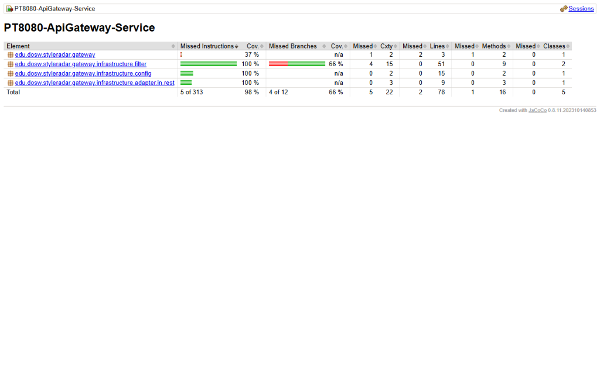

[⬅ Volver al README Principal](../../README.md)

---

## 8. PRUEBAS Y COBERTURA (≥ 85%)

El proyecto exige una cobertura mínima obligatoria del **85%** validada por **JaCoCo** durante la fase `verify` de Maven.

### Comandos de Ejecución

```bash
# Ejecutar suite de pruebas reactivas y validación de Quality Gate
./mvnw clean verify

# Generar reporte HTML de cobertura
./mvnw jacoco:report
```

* **Ruta del Reporte HTML:** `target/site/jacoco/index.html`

### Métricas Actuales de Cobertura en el Repositorio

* **Pruebas Automatizadas:** 69 pruebas unitarias y de integración reactiva ejecutadas.
* **Fallos y Errores:** 0 fallos, 0 errores.
* **Cobertura de Código Nuevo (SonarCloud):** **92.3%** (Quality Gate Passed con Rating A).
* **Cobertura General de Instrucciones:** **96.5%**.
* **Resultado del Build:** `BUILD SUCCESS`.

### Evidencia de Cobertura JaCoCo Verificada (≥ 85%)

<div align="center">
  
  <p><sub><b>Figura 8.1:</b> Reporte oficial consolidado de cobertura HTML generado por JaCoCo (<code>target/site/jacoco/index.html</code>), certificando un 98% de cobertura general de instrucciones, 100% en componentes de filtros, configuración y adaptadores REST, y 97.4% de líneas, superando con holgura el umbral mínimo del 85%.</sub></p>
</div>

---

[⬅ Volver al README Principal](../../README.md)
