[⬅ Volver al README Principal](../../README.md)

---

## 9. CI/CD CON EL BADGE DEL PIPELINE

El ciclo de vida del API Gateway implementa integración continua automatizada mediante **GitHub Actions** en el archivo `.github/workflows/ci.yml`.

### Matriz de Pipelines por Rama Protegida

| Pipeline | Rama / Entorno | Trigger | Quality Gate Requerido | Estado |
| :--- | :---: | :---: | :--- | :---: |
| **CI - Develop** | `develop` *(Staging)* | Push / PR | Compilación + Pruebas + JaCoCo ≥ 85% + Docker Build |  |
| **CI - Main** | `main` *(Producción)* | Push / PR | Compilación + Pruebas + JaCoCo ≥ 85% + Docker Build |  |
| **CD - QA Azure** | `develop` *(Cloud QA)* | Push a `develop` | Build + Pruebas + JaCoCo + SonarCloud + Docker + Azure Deploy + Smoke Test |  |
| **CD - PROD Azure** | `main` *(Cloud PROD)* | Push a `main` / Tag `v*` | Build + Pruebas + JaCoCo + SonarCloud + Docker + Azure Deploy + Smoke Test |  |
| **SonarCloud Gate** | `main`, `develop` *(Estático)* | Push / PR | Gate A (0 Bugs + 0 Vulnerabilidades + JaCoCo ≥ 85%) |  |

### Diagrama del Flujo Automatizado (Pipeline Stages)

```mermaid
flowchart LR
    A["Push / PR<br>(main / develop)"] --> B["Setup JDK 21<br>(Temurin & Cache)"]
    B --> C["Build & Tests<br>(mvn clean verify)"]
    C --> D["JaCoCo Verify<br>(Coverage ≥ 85%)"]
    D --> E["SonarCloud Gate A<br>(Obligatorio)"]
    E --> F["Docker Build & Push<br>(Tags SHA & Latest)"]
    F --> G["Azure Deploy & Smoke Test<br>(Commit SHA Verify)"]

    classDef step fill:#12063A,stroke:#5600EF,stroke-width:2px,color:#FFFFFF;
    classDef pass fill:#DCFCE7,stroke:#16A34A,stroke-width:2px,color:#0C0C12;

    class A,B step;
    class C,D,E,F,G pass;
```

---

[⬅ Volver al README Principal](../../README.md)
