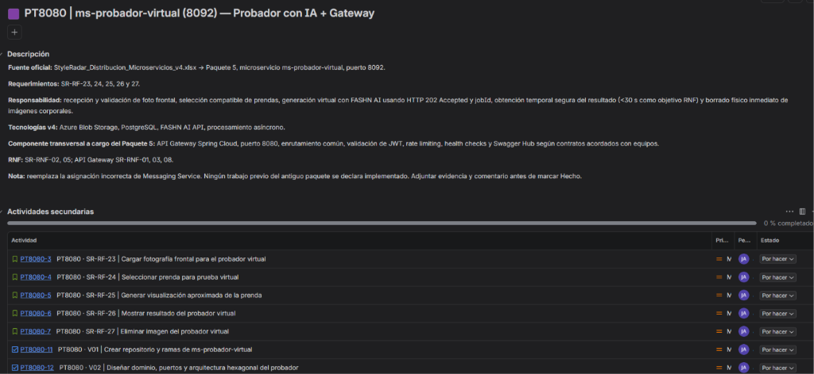

[⬅ Volver al README Principal](../../README.md)

---

## 12. EQUIPO, RESPONSABLES Y ENLACE A LA ÉPICA EN JIRA

### Equipo y Responsables del Microservicio

Desarrollado y mantenido por el **Squad Portal8080 (`PT8080`)** para la asignatura DOSW 2026.

| Rol | Nombre Completo | Usuario GitHub |
| :---: | :---: | :---: |
| **Líder del Equipo** | Daniel Valero Quiroga | [@DanielValeroQ](https://github.com/DanielValeroQ) |
| **Desarrollador Backend** | Jose Alejandro Martinez Arias | [@JoseMartinez883](https://github.com/JoseMartinez883) |
| **Desarrollador Backend** | Juan David Munar | [@JuanDavidMunar](https://github.com/JuanDavidMunar) |
| **Desarrollador Frontend** | Kevin | [@Kevin](https://github.com/StyleRadar1) |

---

### Enlaces de Gestión, Repositorios y Evidencias

* **Repositorio Oficial en GitHub:** [https://github.com/StyleRadar1/PT8080-ApiGateway-Service](https://github.com/StyleRadar1/PT8080-ApiGateway-Service)
* **Organización Oficial de StyleRadar:** [https://github.com/StyleRadar1](https://github.com/StyleRadar1)
* **Épica Oficial del Microservicio (Jira):** [https://mail-team-nyjtgqcj.atlassian.net/browse/PT8080-1?atlOrigin=eyJpIjoiMWE0NjAzMTdkODI5NDFmN2I2ODdhOGYzNjJjMTU4ZTkiLCJwIjoiaiJ9](https://mail-team-nyjtgqcj.atlassian.net/browse/PT8080-1?atlOrigin=eyJpIjoiMWE0NjAzMTdkODI5NDFmN2I2ODdhOGYzNjJjMTU4ZTkiLCJwIjoiaiJ9)
* **Tablero Scrum del Squad (Jira):** [https://mail-team-nyjtgqcj.atlassian.net/jira/software/projects/PT8080/boards/74/backlog?epics=visible&selectedIssue=PT8080-38&atlOrigin=eyJpIjoiMjRlZW](https://mail-team-nyjtgqcj.atlassian.net/jira/software/projects/PT8080/boards/74/backlog?epics=visible&selectedIssue=PT8080-38&atlOrigin=eyJpIjoiMjRlZW)

### Requerimientos No Funcionales Asignados al Gateway

| Código RNF | Nombre del Requerimiento | Métrica / Criterio de Aceptación Clave |
| :---: | :--- | :--- |
| `SR-RNF-01` | **Punto Único de Acceso Perimetral** | Todo el tráfico entrante del frontend debe ingresar obligatoriamente a través del puerto `8080`. |
| `SR-RNF-03` | **Seguridad y Políticas CORS** | Bloqueo perimetral de orígenes no autorizados y validación estricta de encabezados HTTP. |
| `SR-RNF-08` | **Tolerancia a Fallos y Circuit Breaker** | Aislamiento de caídas de microservicios con Resilience4j retornando respuestas de degradación elegante (`Fallback 503`). |
| `SR-RNF-05` | **Latencia de Enrutamiento Mínima** | Procesamiento no bloqueante en memoria con Netty garantizando sobrecarga de enrutamiento menor a 5 ms. |

### Evidencia de la Épica y Tareas en Atlassian Jira

  
  
<b>Figura 12.1:</b> Épica oficial del Squad Portal8080 (<code>PT8080</code>) en Atlassian Jira (<code>ms-probador-virtual (8500) — Probador con IA + Gateway</code>), detallando los requerimientos de perimetría, arquitectura y tareas técnicas del Sprint 1 para el API Gateway y microservicios complementarios.

---

[⬅ Volver al README Principal](../../README.md)
